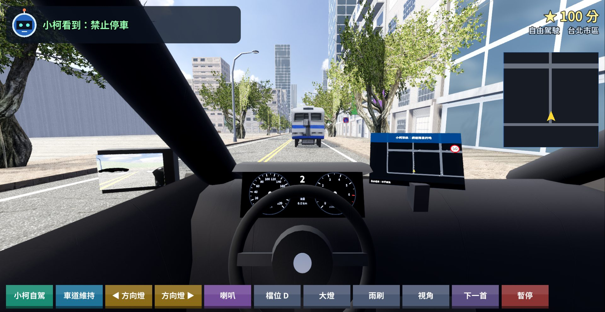

# 眼動鼠之寶島卡車



用眼睛開卡車的 **3D 寫實駕駛遊戲**（Godot 4.7）：坐在駕駛座裡跑遍台灣，小柯機器人陪你學開車。

- **看邊緣轉頭**：眼睛看畫面左右邊緣，頭就轉過去看後照鏡；看回中間就回正。
- **寫實畫面**：HDRI 天空、照片材質、寫實車輛、機車、公車、行道樹與紅綠燈。
- **駕駛座**：曲面儀表板、儀表、方向盤、雨刷、後照鏡，平板導航用語音報路。
- **台灣 7 張地圖**：台北市區、國道、日月潭、高雄、太魯閣、墾丁、駕訓班。
- **交通標誌辨識**：小柯看到標誌會說出名稱與意思。
- **駕訓班 10 課＋10 種考驗**：下雨、夜間、高速公路、寒流起霧、夏天、颱風、塞車、事故、救護車、機車。
- **小柯自駕**：自動跟車、停紅燈、轉彎到目的地。
- **20 首車內音樂、語音動態教學、程式內更新**。

搭配 [眼動鼠](https://github.com/achir1015/eyemouse)（127.0.0.1:47961）使用最好；也可以用滑鼠、鍵盤操作。

下載：<https://achir1015.github.io/eyemouse-truck/>

## 開發

```bash
python -I tools/fetch_polyhaven.py   # Poly Haven CC0 天空與材質
python -I tools/gen_models.py        # NVIDIA TRELLIS 產生車輛模型（需要 NVIDIA_API_KEY）
python -I tools/gen_music.py         # 20 首車內音樂
python -I tools/gen_sfx.py           # 音效
python -I tools/gen_voice.py         # 語音
bash tools/build_win.sh              # Windows 安裝程式＋免安裝 zip → ../build/release
```

測試：`Godot --path . -- --test --screen=selftest`；截圖 `-- --test --screen=drive --map=taipei --vehicle=car --view=chase --shot=畫面.png`。

素材：天空、材質、部分道具來自 [Poly Haven](https://polyhaven.com)（CC0）；車輛與街景模型由 NVIDIA TRELLIS 產生。

系統開發：吳玉柱 先生 與 Claude AI Opus 5.5
